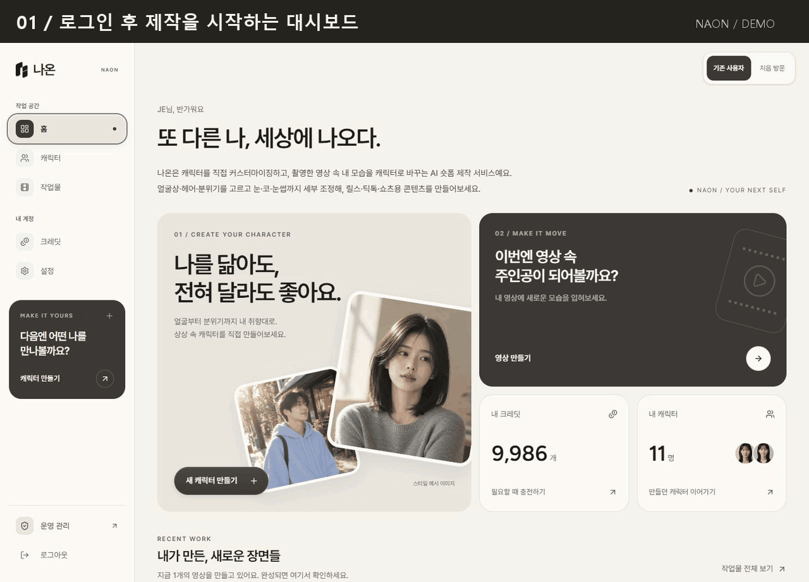
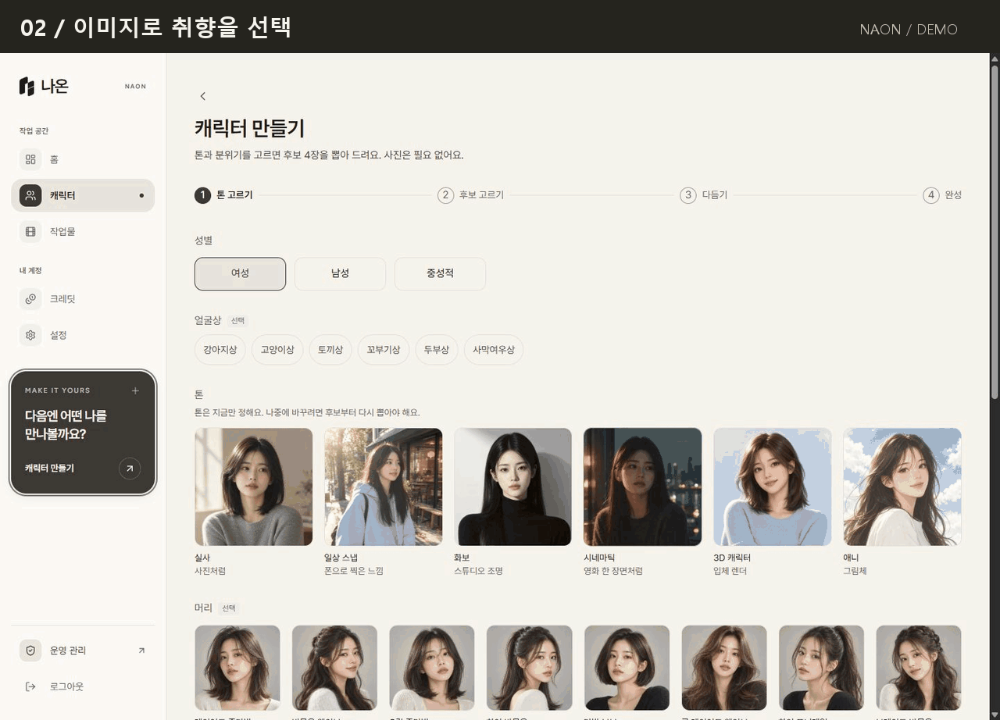
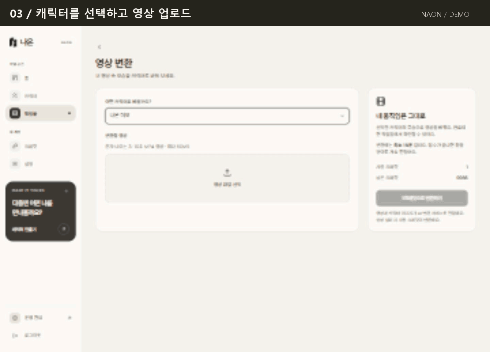

  
  <h1>나온 · NAON</h1>
  
<strong>또 다른 나, 세상에 나오다.</strong>

  
내가 만든 캐릭터로, 내가 촬영한 영상을 새롭게.

  

    
    
    
  

  
AI 캐릭터 커스터마이징 & 숏폼 영상 제작 · 개인 프로젝트

---

**나온은 캐릭터를 만들고 얼굴을 다듬어, 내 영상에 적용하는 웹 서비스입니다.**

## 주요 기능 미리보기

로그인 없이 아래 GIF로 캐릭터 생성부터 영상 변환까지 살펴볼 수 있습니다. GIF를 누르면 크게 볼 수 있습니다.

### 🔳 로그인 후 대시보드

최근 작업, 내 캐릭터, 진행 중인 영상과 크레딧을 한 화면에서 확인합니다. 첫 제작을 시작하거나 이전 작업을 이어갈 수 있는 스튜디오의 출발점입니다.

### 💇🏻‍♀️ 캐릭터 생성 & 커스터마이징

> 💡 영상 변환을 테스트하려고 직접 만들고 커스터마이징한 캐릭터입니다.

**스타일·얼굴상·헤어 선택 → 후보 4장 생성 → 얼굴 세부 조정 → 캐릭터 완성.**

이미지로 원하는 분위기를 고르고 눈·코·눈썹 등을 슬라이더로 다듬습니다. 미리보기와 AI 수정 결과를 구분하고, 완성 단계에서는 수정한 정면을 보존하고 왼쪽·오른쪽 45° 이미지를 추가합니다.

### 📹️ 영상 업로드 & 변환

> 💡 커스터마이징한 캐릭터가 영상에 잘 반영되는지 확인한 테스트입니다.

**캐릭터 선택 → 원본 영상 업로드 → 변환 접수·진행 확인 → 결과 재생·다운로드.**

3~10초 MP4 영상을 올리면 영상 속 모습을 선택한 캐릭터로 바꿉니다. 접수 후 창을 닫아도 처리가 이어지고, 작업물 화면에서 상태와 결과를 확인할 수 있습니다. 실제 변환은 최소 15분으로 안내하며, 시연에서는 긴 대기 구간을 축약합니다. GIF에는 실제 업로드·진행·완료와 결과 재생을 담았습니다.

2026-10-07 배포 버전의 실제 화면입니다. 캐릭터·영상 시연은 각각 별도 작업으로 촬영했습니다. [촬영 정보](docs/media/README.md)

## 직접 설계하고 구현한 부분

기획부터 화면 설계, AI 연동, 데이터·파일 관리, 크레딧 처리와 관리자 기능까지 구현한 개인 프로젝트입니다.

| 설계 과제 | 구현 방식 |
| :--- | :--- |
| 복잡한 생성 옵션을 쉽게 선택하기 | 이미지 카탈로그와 속성 선택, 슬라이더 기반 얼굴 편집 |
| 미리보기와 최종 결과의 차이를 전달하기 | 수정 적용 여부를 표시하고, 저장된 이미지에 조정값이 중복 적용되지 않도록 처리 |
| 오래 걸리는 AI 작업의 상태 전달 | 단계·경과 시간·생성 이미지 수 표시, Realtime 상태 갱신과 실패 시 재시도 |
| 비용이 발생하는 요청을 안전하게 처리하기 | Edge Function에서 생성·차감 처리, 중복 요청과 반복 환불 방지 |
| 사용자별 데이터와 결과물 보호 | Supabase RLS, private 버킷, 서버에서 발급한 signed URL |
| 제작 이후의 운영까지 연결하기 | 크레딧 사용·환불 내역, 관리자 사용자 검색·수동 충전·입금 안내 관리 |

## 현재 범위

캐릭터 생성·세부 조정·3방향 완성, 영상 변환·작업물 관리, 크레딧 내역과 관리자 기능을 구현했습니다. **개발 중인 서비스**로, 생성 품질과 실패 복구·모바일 전체 흐름을 검증하고 있습니다.

Google 로그인을 지원하며 Kakao 로그인과 자동 결제는 후속 작업입니다. 의상·배경을 바꾸는 룩 기능은 현재 화면에서 비활성화되어 있습니다.

[개발 현황](todo.md) · [서비스 기획](docs/기획서.md) · [캐릭터 생성 설계](docs/캐릭터-생성-프롬프트.md) · [진행 안내와 재시도](docs/생성-재시도-진행안내.md)

<strong>어떻게 만들었나요?</strong>

 

| 역할 | 사용 기술 |
| :--- | :--- |
| 웹 화면 |     |
| 로그인·데이터·파일·진행 상태 |  |
| 캐릭터 이미지 생성 |  |
| 영상 변환 |   |
| 웹 배포 |  |

---

<strong>나온 · NAON</strong> 내 캐릭터로 만드는 짧은 영상.

