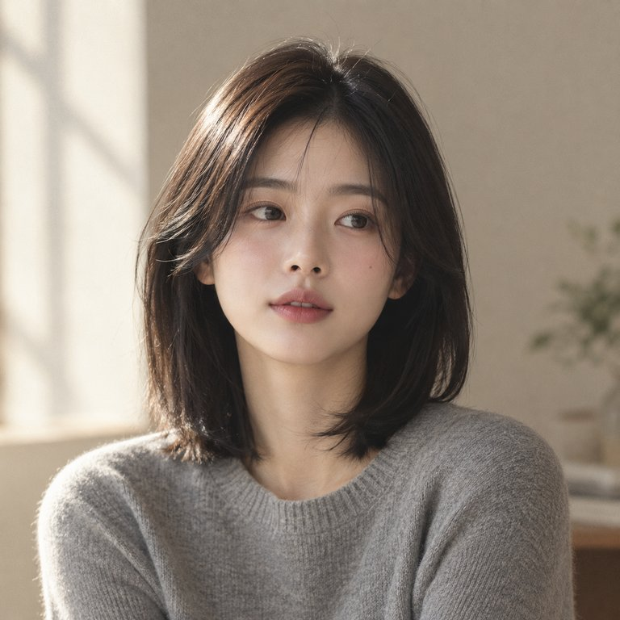
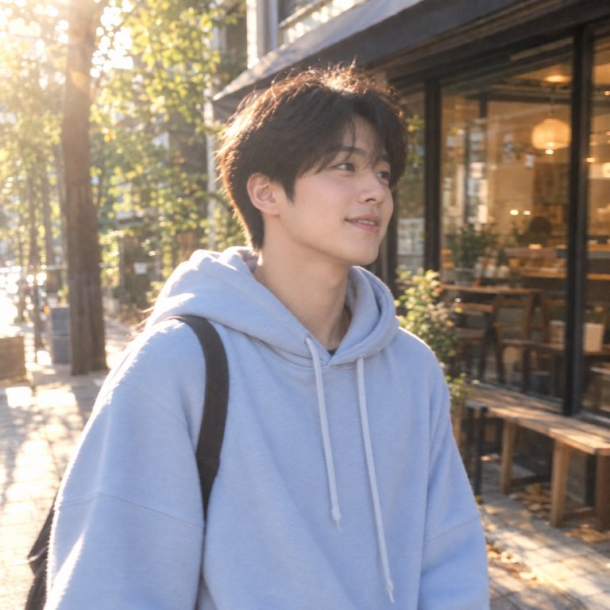
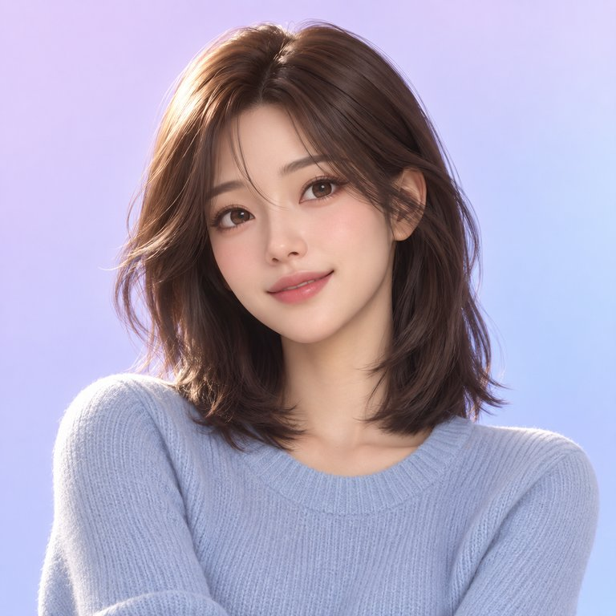

  
  <h1>나온 · NAON</h1>
  
<strong>또 다른 나, 세상에 나오다.</strong>

  
내가 만든 캐릭터로, 내가 촬영한 영상을 새롭게.

  

    
    
    
  

  
AI 캐릭터 커스터마이징 & 숏폼 영상 제작 · 개인 프로젝트

---

## 나만의 캐릭터가 영상 속 주인공이 된다면

**나온은 캐릭터를 직접 만들고, 촬영한 영상 속 내 모습을 그 캐릭터로 바꾸는 AI 숏폼 제작 서비스입니다.**

얼굴상과 헤어, 분위기를 고르고 눈·코·눈썹까지 다듬어 나만의 캐릭터를 완성합니다. 여기에 짧은 영상을 더하면 릴스·틱톡·쇼츠에 활용할 콘텐츠를 만들 수 있습니다. 복잡한 생성 명령어 대신 **사진을 고르고 슬라이더를 움직이는 방식**으로 제작합니다.

<table>
  <tr>
    <td align="center" width="33%"></td>
    <td align="center" width="33%"></td>
    <td align="center" width="33%"></td>
  </tr>
  <tr>
    <td align="center"><strong>사진 같은 자연스러움</strong></td>
    <td align="center"><strong>취향을 담은 분위기</strong></td>
    <td align="center"><strong>상상 속 캐릭터까지</strong></td>
  </tr>
</table>

서비스에서 사용하는 스타일 선택용 카탈로그 이미지입니다. 영상 변환 결과 예시는 아닙니다.

## 원하는 모습을 고르세요

실사·일상 스냅·화보·시네마틱·3D·애니, **6가지 스타일**에서 시작합니다. 성별 표현, 얼굴상, 머리 모양과 색, 나이대와 분위기를 조합하면 AI가 **캐릭터 후보 4장**을 제안합니다.

## 마음에 드는 얼굴을 더 나답게

후보를 선택하고 눈의 크기, 코, 턱선, 눈썹과 메이크업을 세부 조정합니다. 슬라이더로 변화를 미리 보고, 수정을 적용해 새 결과를 받아볼 수 있습니다. 이전 얼굴로 되돌리거나 후보를 다시 뽑는 것도 가능합니다.

> 미리보기와 AI가 생성한 결과를 구분합니다. 아직 적용하지 않은 수정이 있으면 먼저 적용하거나 되돌린 뒤 완성하도록 안내합니다.

## 여러 각도에서도 같은 캐릭터로

이름을 붙이고 완성하면 **정면·왼쪽 45°·오른쪽 45°** 이미지를 생성합니다. 완성된 캐릭터는 보관함에서 관리하고 영상 제작에 다시 사용할 수 있습니다.

## 내 움직임에 새로운 모습을 입히세요

혼자 등장하는 **3~10초 MP4 영상**을 올리고 캐릭터를 선택합니다. 변환된 영상은 작업물에서 재생하고 내려받을 수 있습니다.

- **업로드:** 최대 50MB
- **결과:** 720p 영상
- **대기 안내:** 최소 15분으로 안내하며, 접수가 끝나면 창을 닫아도 처리가 이어집니다.

## 만드는 과정도 편안하게

| 경험 | 나온에서 할 수 있는 일 |
| :--- | :--- |
| **한곳에서 이어 만드는 스튜디오** | 홈에서 최근 작업, 내 캐릭터, 진행 중인 영상과 크레딧을 확인합니다. |
| **기다리는 동안에도 진행 상황 확인** | 생성 단계, 경과 시간, 저장된 이미지 수를 확인하고 실패한 작업을 다시 시도합니다. |
| **사용 내역이 보이는 크레딧** | 보유 잔액과 사용·환불 기록을 확인합니다. 수동 입금 충전 안내와 운영자 처리 기능을 구현했습니다. |
| **모바일에서도 자연스럽게** | 크림·차콜 색상과 카드 중심 화면, 모바일 내비게이션으로 제작 흐름을 이어갑니다. |
| **운영까지 이어지는 관리 도구** | 관리자는 사용자 검색, 크레딧 충전, 거래 기록, 요금제·입금 안내를 관리합니다. |

## 작은 디테일까지 설계했습니다

**선택은 쉽게, 조정은 섬세하게.** 스타일과 헤어는 이미지로 비교하고, 얼굴은 슬라이더로 다듬습니다. 긴 프롬프트를 작성하지 않아도 취향을 표현할 수 있도록 구성했습니다.

**완성할 얼굴을 정확히 알 수 있도록.** 저장된 이미지에 같은 조정이 두 번 겹치지 않도록 미리보기를 개선하고, 3방향 생성의 좌우 기준을 화면을 보는 사람 기준으로 명확히 했습니다.

**실패했을 때도 다음 행동이 보이도록.** 진행 안내와 재시도 버튼을 제공하고, 중복 요청과 반복 환불을 방지하는 처리를 구현했습니다. 추가 비용이 드는 생성 요청을 자동으로 재시도하지 않습니다.

## 지금의 나온

캐릭터 제작, 영상 변환, 작업물 관리와 관리자 화면을 구현한 **개발 중인 서비스**입니다. 실제 생성 품질과 운영 환경의 전체 흐름은 추가 검증을 이어가고 있습니다.

| 구분 | 현재 범위 |
| :--- | :--- |
| 구현 | 캐릭터 생성·세부 조정·3방향 완성, 영상 변환·재생·다운로드, 크레딧 내역, 관리자·수동 충전 |
| 로그인 | Google 로그인 구현 · Kakao 로그인 준비 중 |
| 보류 | 의상·배경을 바꾸는 룩 기능은 현재 화면에서 비활성화 |
| 후속 작업 | 자동 결제 연동, 유료 운영 준비, 생성 품질·실패 복구·모바일 전체 흐름 검증 |

세부 완료 내역과 남은 작업은 **[todo.md](todo.md)** 에서 관리합니다.

<strong>어떻게 만들었나요?</strong>

 

| 역할 | 사용 기술 |
| :--- | :--- |
| 웹 화면 |     |
| 로그인·데이터·파일·진행 상태 |  |
| 캐릭터 이미지 생성 |  |
| 영상 변환 |   |
| 웹 배포 |  |

기획부터 캐릭터 편집 경험, AI 생성 연동, 크레딧 처리, 운영자 화면까지 연결한 개인 프로젝트입니다.

[서비스 기획](docs/기획서.md) · [캐릭터 생성 설계](docs/캐릭터-생성-프롬프트.md) · [진행 안내와 재시도](docs/생성-재시도-진행안내.md)

---

<strong>나온 · NAON</strong> 내 캐릭터로 만드는 짧은 영상.

